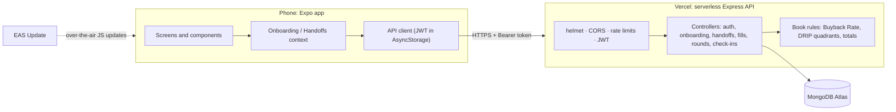

# Lifeora: buy back your time

[](https://github.com/UroojMajeed/lifeora/actions/workflows/ci.yml)


A mobile app that helps founders and freelancers find the work that drains them, hand it off, and spend the hours they win back on work that matters. It turns the method from Dan Martell's book *Buy Back Your Time* into a guided, step-by-step loop.

**[Download the Android app (APK)](https://expo.dev/artifacts/eas/fohG1fTb6_ZrKDXCH3k3bgJHnprgvs4ZMTslEk6shbM.apk)** · **[Project guide](PROJECT_GUIDE.md)**

<!--
Screenshots: add PNGs to docs/screenshots/ with these names, then remove this comment's markers.

| Onboarding | Time and energy audit | DRIP Matrix | Home | Handing off a task |
|---|---|---|---|---|
|  |  |  |  |  |
-->

---

## What it does

1. **Know your worth.** Enter your yearly pay and the app works out your hourly worth and your **Buyback Rate**: the most you should pay someone to take a task off your plate (hourly worth ÷ 4).
2. **Audit your day.** List what you do on a normal work day: how long each task takes, what it pays ($ to $$$$$), and whether it drains or energizes you.
3. **See your DRIP Matrix.** Every task lands in Delegation, Replacement, Investment or Production, so it's clear what to hand off first.
4. **Hand it off, step by step.** Each draining task gets its own road: choose how (hire, automate, give it to the team, or drop it), write a short brief, find who, and hand it over. Ready-made drafts and ideas help at each step.
5. **Make it stick.** A weekly check-in asks whether each handed-off task stayed off your plate, and a task that slipped back returns to your list. Local reminders nudge you on the start day and when the check-in is due.
6. **Reinvest the hours.** Freed time gets a new job in Production or Investment, and progress is shown as hours bought back each week, with milestones along the way.

No sign-up wall: "Get started" creates a guest account in the background, and you can save it as a real account once there's progress to keep.

## Tech stack

| Layer | Tools |
|---|---|
| App | React Native 0.86, **Expo SDK 57**, React 19, React Navigation (native stack + custom tab bar), Reanimated 4, react-native-svg, expo-notifications, AsyncStorage |
| API | **Node.js**, **Express 4**, **Mongoose 8**, JWT auth, bcrypt, helmet, express-rate-limit |
| Data | **MongoDB Atlas** |
| Hosting and release | **Vercel** (serverless API, deploys on push to `main`), **EAS Build** and **EAS Update** (Android builds and over-the-air updates) |
| Quality | **Jest**, Supertest, mongodb-memory-server, jest-expo, **GitHub Actions** CI |

## Architecture



- **The server owns the rules.** The Buyback Rate, each task's DRIP quadrant and every total are computed on the API, never trusted from the app.
- **One document per user** holds the routine, handoffs, fills, rounds and check-ins: simple and fast at this size, with input limits on every list.
- **Saves as you go.** Each onboarding step and handoff step is saved immediately, so closing the app never loses progress.

## Engineering highlights

- **Guest-first auth:** a guest account and a one-year JWT on first open, upgraded to an email account later without losing data.
- **Security basics:** helmet headers, CORS, rate limits (stricter on login and sign-up), bcrypt password hashing, and validation with length limits on every field.
- **Serverless-friendly database connection:** one Mongoose connection reused across requests, with clear 500/503 errors when the server is misconfigured or the database is down.
- **Tested:** 27 backend tests run the real Express app against an in-memory MongoDB (onboarding, handoffs, slip-back, renames, check-ins, accounts), and 22 tests cover the app's own logic (the handoff road, Home's next move, the Buyback Loop).
- **CI on every pull request:** both test suites plus a full Android bundle build.
- **Real release process:** separate development, preview and production build profiles, and over-the-air updates to testers.

## Project structure

```
lifeora/
├── backend/                 Express API
│   ├── api/index.js         Vercel entry (connects to MongoDB, then hands off to Express)
│   ├── src/
│   │   ├── app.js           middleware and routes
│   │   ├── controllers/     auth, onboarding, handoffs (+ fills, rounds), check-ins, progress
│   │   ├── models/User.js   the user document
│   │   ├── utils/buyback.js the book's formulas and reference data
│   │   └── middleware/      JWT auth, error handler
│   ├── scripts/             backups and guest clean-up
│   └── tests/               API and formula tests
├── frontend/                Expo app
│   ├── src/
│   │   ├── screens/         onboarding, Home, handoff journey, check-ins, routine, account
│   │   ├── components/      reusable UI (cards, sheets, the winding road, charts)
│   │   ├── context/         onboarding and handoffs state
│   │   ├── constants/       content, the handoff journey, Home logic
│   │   ├── theme/           colour tokens and fonts
│   │   └── api/client.js    API calls
│   └── tests/               logic tests
├── .github/workflows/ci.yml CI
└── PROJECT_GUIDE.md         full guide: setup, shipping, data, screens, design rules
```

## Run it locally

You need Node.js 18 or newer, a MongoDB (local, or a free Atlas cluster), and the Expo Go app or an Android emulator.

```bash
# API
cd backend
cp .env.example .env     # set MONGODB_URI and a long random JWT_SECRET
npm install
npm run dev              # http://localhost:5000/api/health

# App (in a second terminal)
cd frontend
cp .env.example .env     # set EXPO_PUBLIC_API_URL, e.g. http://10.0.2.2:5000/api for the Android emulator
npm install
npx expo start
```

For a phone on the same Wi-Fi, use `http://<your-computer's-LAN-IP>:5000/api`. More detail, including builds and updates, is in [PROJECT_GUIDE.md](PROJECT_GUIDE.md).

## Tests

```bash
cd backend && npm test     # API tests on a throwaway in-memory MongoDB, no setup needed
cd frontend && npm test    # the app's logic
```

GitHub Actions runs both, plus an Android bundle build, on every pull request and every push to `main`.

## API

All routes are under `/api` and need a Bearer token unless marked.

| Method | Path | What it does |
|---|---|---|
| GET | `/health` | Health check (no token) |
| POST | `/auth/guest` | Start as a guest; returns a token (no token) |
| POST | `/auth/register`, `/auth/login` | Email account (no token) |
| POST | `/auth/save` | Turn a guest into an email account |
| GET, PATCH, DELETE | `/auth/me` | The account: read, update, delete |
| GET, PUT | `/onboarding` | Pay, currency and the routine; the server computes the Buyback Rate and quadrants |
| POST | `/onboarding/complete` | Finish onboarding |
| GET | `/handoffs` | Draining tasks with their progress, plus totals (hours bought back, per week) |
| PUT | `/handoffs/:activity` | Update a handoff: method, steps, brief, who, start date, status |
| POST | `/handoffs/:activity/slip` | A handed-off task came back |
| PUT | `/fills` | Where the freed hours go |
| POST | `/rounds/next` | Start the next round of the loop |
| POST | `/checkins` | The weekly check-in |
| GET, PATCH | `/progress` | Milestones |

## Design

Calm and clean: a teal and evergreen palette with a warm apricot accent, the Plus Jakarta Sans typeface, little text, and tap rather than type. Colour tokens live in `frontend/src/theme/index.js`, and brand files are in `frontend/assets/brand/`.

## Roadmap

- Reminders in the next Android build (they're in the code; the current tester build predates them) and sharing progress as an image
- A production database separate from testers' data
- Google Play release

---

Built by [Urooj Majeed](https://github.com/UroojMajeed). Based on the ideas in *Buy Back Your Time* by Dan Martell; Lifeora is an independent project and isn't affiliated with the author.
